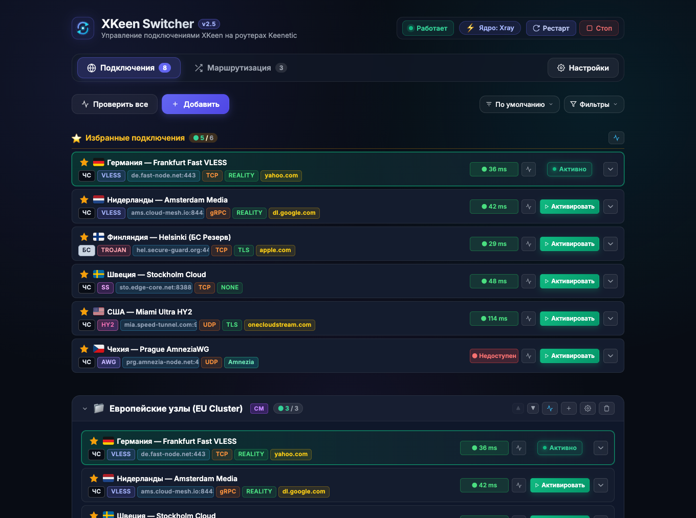
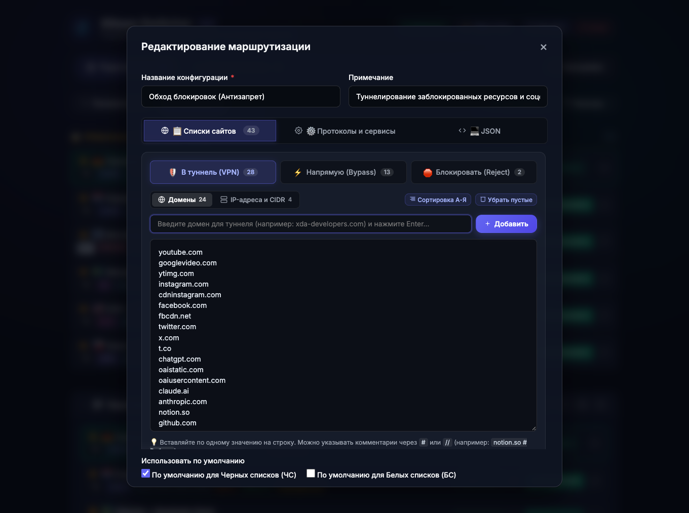
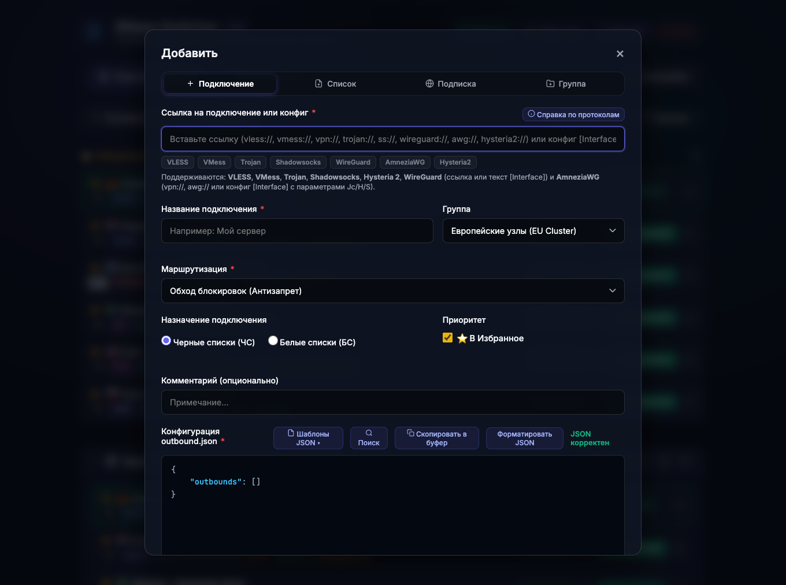
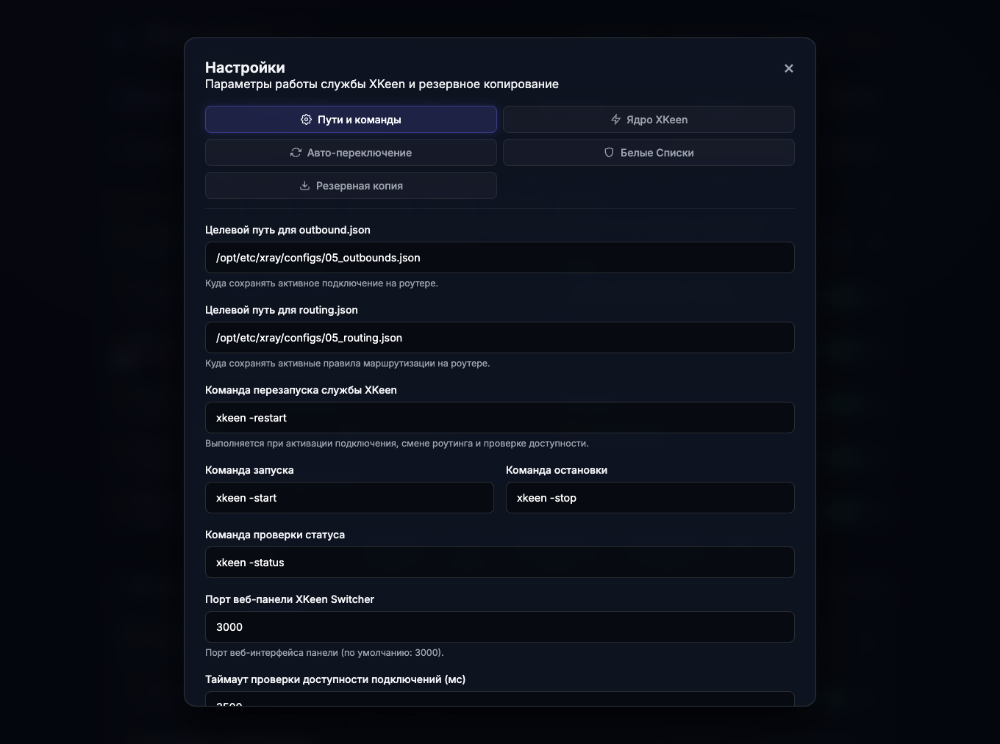

# 🚀 XKeenSwitcher

Современная веб-панель для управления исходящими подключениями (Outbounds) и модульной маршрутизацией (Routing) для **XKeen (Xray / Mihomo / sing-box)** на роутерах с установленной средой **Entware** (Keenetic, OpenWrt, Asuswrt-Merlin и др.).

<p align="center">
  
</p>

---

## ✨ Возможности

### ⚡ Мульти-ядерная архитектура (Xray & Mihomo)
- **Переключение ядер в 1 клик:** Бесшовный переход между ядрами **Xray** и **Mihomo (Clash.Meta)** прямо из шапки интерфейса.
- **Автоматическая адаптация конфигураций:** Панель самостоятельно генерирует синтаксически корректные конфиги для активного ядра (`05_outbounds.json` + `05_routing.json` для Xray и `config.yaml` для Mihomo).

### 🛡️ Поддержка современных протоколов обхода блокировок
- **AmneziaWG (AWG 3.0 / 3.1):** Нативная поддержка параметров обфускации (`Jc`, `Jmin`, `Jmax`, `S1`, `S2`, заголовки `H1-H4`) через ядро Mihomo. Импорт ссылок `vpn://`, `awg://` и текстовых конфигураций `[Interface]`.
- **Hysteria 2 (`hy2://`):** Скоростной протокол на базе UDP с маскировкой под HTTP/3 для обхода жесткого замедления трафика.
- **WireGuard (`wg://`):** Поддержка классического WireGuard и файлов `[Interface]` с поддержкой IPv6.
- **Xray расширения:** VLESS (с поддержкой Reality, Flow, gRPC, WebSocket, xhttp), VMess, Trojan и Shadowsocks.

### 📦 Подписки, Группы и Пакетный импорт
- **Импорт подписок по URL:** Поддержка провайдерских подписок, автоматическое распознавание названий (`profile-title`) и поддержка HWID.
- **Пользовательские группы серверов:** Организация подключений по странам или категориям с возможностью сортировки, группового замера пинга, перемещения и копирования.
- **Закреплённое Избранное (★ Favorites):** Быстрый доступ к ключевым серверам вверху списка.
- **Пакетный импорт (Batch Import):** Добавление десятков серверов одной вставкой списка ссылок.

### 🎨 Современный Compact Accordion UI
- **Компактные карточки-аккордеоны:** Плотная и информативная вёрстка, оптимизированная для работы с сотнями серверов.
- **Умная единая фильтрация (Unified Filters):** Быстрый поиск и фильтрация по протоколам, транспортам, странам и типам списков (ЧС / БС / СМ) с динамическим скрытием неиспользуемых опций.
- **Цветные бейджи и индикаторы:** Наглядное отображение протоколов, сетевых транспортов и живой индикатор активного сервера.

### 🌐 Универсальный визуальный конструктор маршрутизации
- **Визуальное управление списками:** Разделение правил на **«В туннель (VPN)»**, **«Напрямую (Bypass)»** и **«Блокировать (Reject)»**.
- **Раздельные вкладки для доменов и IP/CIDR.**
- **Строка быстрого добавления (Quick Add):** Автоматическая очистка URL и протоколов при вставке.
- **Инструменты в 1 клик:** Сортировка по алфавиту (А-Я), удаление дубликатов, очистка пустых строк и поддержка комментариев (`#`, `//`).
- **Специальные сервисы:** Переключатели для BitTorrent (P2P), QUIC (HTTP/3) и звонков (VoIP/STUN).
- **Базы GeoSite / GeoIP:** Мониторинг размера, статуса и встроенное автообновление geodata.

### 🛡️ Отказоустойчивость и Белые Списки (Failover & Auto-Failover)
- **Резервные пулы подключений (Backup Pool):** Автоматическое переключение на пул резервных серверов при аварии или блокировке основного узла.
- **Стратегии пула:** *Lowest Ping* (автовыбор самого быстрого) и *Round-Robin*.
- **Реальное сквозное тестирование туннеля (Canary Probe):** Изолированная проверка прохождения трафика, исключающая ложные срабатывания на заблокированных серверах с открытым портом.
- **Автоматический возврат (Failback):** Бесшовный возврат на основной сервер при восстановлении связи.

### 📊 Мониторинг, Диагностика и Бэкапы
- **Диагностические логи (`/api/diag/logs`):** Просмотр логов XKeen/Xray/Mihomo прямо в веб-интерфейсе.
- **Резервное копирование (Backup & Restore):** Быстрый экспорт и импорт базы подключений, групп и роутингов в архив ZIP или JSON.
- **Встроенное автообновление:** Проверка новых релизов на GitHub прямо в интерфейсе и обновление в 1 клик с автоматическим бэкапом конфигураций.

---

## 📸 Интерфейс

| Главная панель (Компактный список) | Конструктор маршрутизации |
| :---: | :---: |
|  |  |

| Добавление подключений и подписок | Настройки и Резервные пулы |
| :---: | :---: |
|  |  |

---

## 📥 Быстрая установка в Entware

Подключитесь к роутеру по SSH и выполните одну команду:

```bash
curl -sL https://raw.githubusercontent.com/sergey1900/XKeenSwitcher/main/install.sh | sh
```

*(Если репозиторий приватный, скрипт запросит GitHub Token или вы можете передать его заранее: `GITHUB_TOKEN="ваш_токен" sh install.sh`)*

Веб-панель будет доступна по адресу: **`http://192.168.1.1:3000`** *(или IP вашего роутера)*.

### Что делает скрипт установки:
1. Проверяет наличие среды Entware и необходимых утилит (`node`, `curl`, `tar`, `ca-certificates`). При необходимости автоматически доустанавливает их через `opkg`.
2. Скачивает и распаковывает приложение в каталог `/opt/etc/xkeen-switcher`.
3. Автоматически находит существующие конфиги Xray/Mihomo/XKeen и импортирует их.
4. Настраивает и запускает фоновую системную службу `/opt/etc/init.d/S99xkeen-switcher`.

---

## 🔄 Обновление

- **Способ 1 (через веб-интерфейс):** Если доступна новая версия, в нижнем баре появится кнопка **«Обновить»**. Нажмите её и подтвердите запуск — панель сама скачает обновление, сохранит бэкап настроек и перезапустится.
- **Способ 2 (через терминал):** Запустите команду установки повторно:
  ```bash
  curl -sL https://raw.githubusercontent.com/sergey1900/XKeenSwitcher/main/install.sh | sh
  ```
  Ваши настройки, группы и профили (`data/profiles.json`) сохранятся автоматически.

---

## 🛠️ Управление службой вручную

- **Статус службы:** `/opt/etc/init.d/S99xkeen-switcher status`
- **Запуск:** `/opt/etc/init.d/S99xkeen-switcher start`
- **Остановка:** `/opt/etc/init.d/S99xkeen-switcher stop`
- **Перезапуск:** `/opt/etc/init.d/S99xkeen-switcher restart`
- **Просмотр логов:** `tail -f /opt/var/log/xkeen-switcher.log`

---

## 🗑️ Удаление (Деинсталляция)

Если вам потребуется удалить панель с роутера:

- **Автоматическое удаление (рекомендуется):**
  ```bash
  curl -sL https://raw.githubusercontent.com/sergey1900/XKeenSwitcher/main/uninstall.sh | sh
  ```
  Скрипт остановит службу, удалит файлы приложения `/opt/etc/xkeen-switcher`, скрипт автозапуска `/opt/etc/init.d/S99xkeen-switcher`, логи и предложит опционально удалить Node.js.

- **Удаление вручную (через SSH):**
  ```bash
  /opt/etc/init.d/S99xkeen-switcher stop
  rm -f /opt/etc/init.d/S99xkeen-switcher
  rm -rf /opt/etc/xkeen-switcher
  rm -f /opt/var/log/xkeen-switcher.log
  ```
