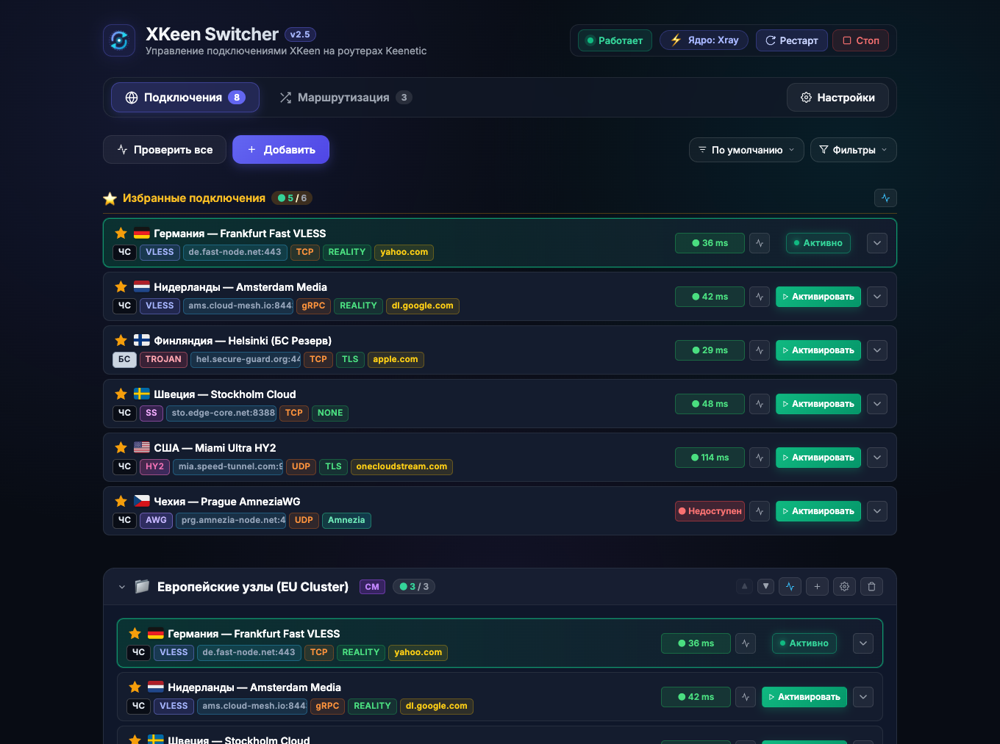
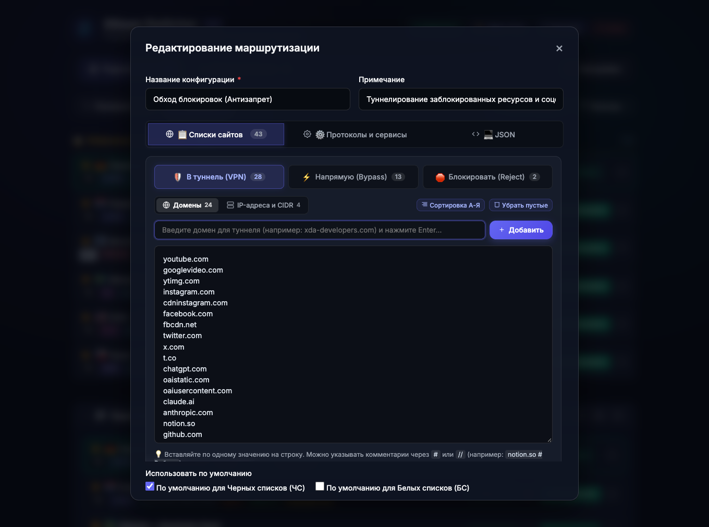
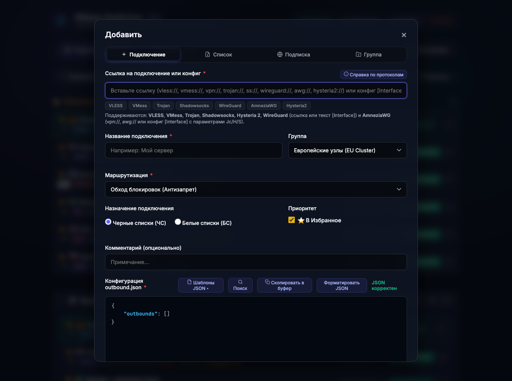
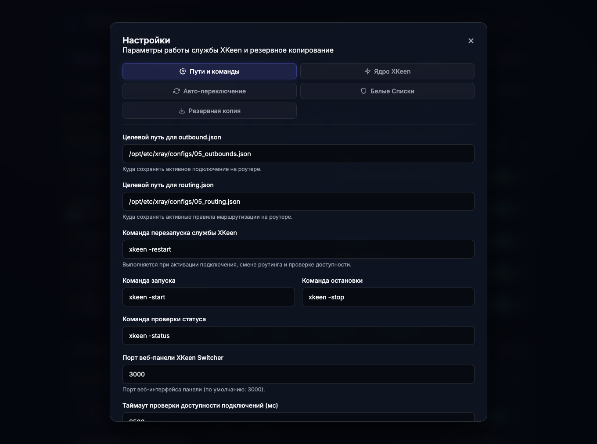

# 🚀 XKeenSwitcher v2.5.0

Глобальное обновление веб-панели управления для **XKeen (Xray / Mihomo / sing-box)** на роутерах с **Entware** (Keenetic, OpenWrt и др.). 

Версия **v2.5.0** — крупнейший релиз в истории проекта, превращающий панель из переключателя конфигураций в полноценный комбайн управления прокси-трафиком роутера: с поддержкой двух ядер (**Xray** и **Mihomo**), современных протоколов обхода блокировок (**AmneziaWG**, **Hysteria 2**, **WireGuard**, **VLESS Reality**), подписок, визуального конструктора правил и полностью переработанного компактного интерфейса.

<p align="center">
  
</p>

---

## 🌟 Ключевые нововведения v2.5.0 (все изменения с v2.0.1):

### 1. ⚡ Мульти-ядерная архитектура: Xray & Mihomo (Clash.Meta)
- **Мгновенное переключение ядер в 1 клик:** Переключайтесь между классическим **Xray** и производительным ядром **Mihomo** прямо из шапки интерфейса без ручного редактирования файлов роутера.
- **Автоматическая конвертация конфигураций:** Панель сама генерирует валидные конфигурации для активного ядра (`05_outbounds.json` + `05_routing.json` для Xray либо `config.yaml` для Mihomo).
- **Прозрачное проксирование:** Корректная интеграция со стандартными портами редиректа/TProxy и встроенная защита от конфликтов с DNS-сервером роутера.

### 2. 🛡️ Поддержка современных протоколов: AmneziaWG, Hysteria 2 и WireGuard
- **AmneziaWG (AWG 3.0 / 3.1):** Нативная поддержка продвинутых параметров обфускации (`Jc`, `Jmin`, `Jmax`, `S1`, `S2`, диапазоны `H1-H4`) через ядро Mihomo. Импорт по ссылкам `vpn://`, `awg://` и текстовым конфигурациям `[Interface]`.
- **Hysteria 2 (`hy2://`):** Поддержка скоростного UDP-протокола с маскировкой под HTTP/3 для работы в условиях жесткого троттлинга трафика.
- **WireGuard (`wg://`):** Полная поддержка стандартного WireGuard и импорта файлов `[Interface]` с поддержкой IPv6.
- **Расширения Xray:** Поддержка транспортов `xhttp`, `gRPC`, `WebSocket`, `TCP Reality`, а также протоколов `Trojan`, `Shadowsocks`, `VMess` и `VLESS`.

### 3. 📦 Подписки (Subscriptions) и Управление Группами (Groups)
- **Импорт подписок по URL:** Быстрое добавление подписок провайдеров с поддержкой HWID-аутентификации и автосинхронизацией.
- **Автоопределение названий:** Автоматическое извлечение названий профилей из заголовков `profile-title`, `content-disposition` и содержимого подписки.
- **Пользовательские группы серверов:** Организация подключений по странам, тарифам или назначению. Доступно быстрое перемещение, копирование и ручная сортировка порядка групп.
- **Пакетный импорт (Batch Import):** Массовое добавление десятков серверов одной вставкой списка ссылок с автоматической привязкой к группе и роутингу.
- **Скрытие недоступных серверов:** Возможность скрыть узлы с тайм-аутом пинга, оставляя в списке только реально работающие серверы.

### 4. 🎨 Полностью переработанный интерфейс (Compact Accordion UI)
- **Компактный режим аккордеонов:** Новый адаптивный дизайн карточек экономит до 70% экранного пространства, позволяя комфортно работать с базами из сотен серверов.
- **★ Избранные подключения (Favorites):** Закрепленная верхняя секция с возможностью быстрого переключения и отдельной кнопкой проверки задержки избранных узлов.
- **Высококонтрастные и цветные бейджи:** 
  - Протоколы: `VLESS`, `TROJAN`, `SS`, `HY2`, `AWG` (цветовая дифференциация).
  - Транспорты: `TCP`, `UDP`, `gRPC`.
  - Типы списков: **ЧС** (Черные списки), **БС** (Белые списки), **СМ** (Смешанный режим).
- **Живая индикация активного сервера:** Пульсирующий индикатор и выделение активного контура.
- **Единый умный фильтр (Unified Filters Dropdown):** Мультиселект по протоколам, транспортам, странам и типам списков. Опции, которых нет в текущей базе, динамически скрываются.

### 5. 🌐 Универсальный визуальный конструктор маршрутизации (Routing Builder)
- **Визуальное составление правил:** Полноценный конструктор списков без необходимости ручной правки сложного JSON.
- **Разделение направлений трафика:**
  - 🛡️ **В туннель (VPN)** — обход блокировок для выбранных ресурсов.
  - ⚡ **Напрямую (Bypass)** — прямой доступ для банков, Госуслуг и локальных сервисов.
  - 🛑 **Блокировать (Reject)** — блокировка рекламы, телеметрии и нежелательных узлов.
- **Раздельные вкладки:** Независимые списки для доменов и IP-адресов/подсетей (CIDR).
- **Строка быстрого добавления (Quick Add):** Мгновенная вставка хостов с автоматической очисткой ссылок (превращает `https://instagram.com/p/123` в `instagram.com`).
- **Поддержка комментариев:** Возможность комментировать строки (`#`, `//`, `;`) прямо в списках хостов.
- **Инструменты оптимизации в 1 клик:** Сортировка по алфавиту (А-Я), автоматическое удаление дубликатов и очистка пустых строк.
- **Управление сервисами:** Отдельные тумблеры для BitTorrent/P2P-трафика, QUIC (HTTP/3) и звонков (VoIP/STUN).
- **Базы GeoSite / GeoIP:** Отображение статуса наличия, размера файлов баз и переключатель автообновления geodata.

### 6. 🛡️ Продвинутая отказоустойчивость: Резервные пулы и стратегии Failover
- **Пул резервных серверов (Backup Pool):** Выбор пула серверов для автоматического переключения при падении основного узла или включении режима Белых Списков.
- **Интеллектуальные стратегии:**
  - *Lowest Ping:* автоматический выбор самого быстрого резервного узла с наименьшей задержкой.
  - *Round-Robin:* циклическое переключение по списку резервных серверов.
- **Фильтрация пула:** Возможность ограничить резерв только серверами, маркированными как «Белые списки (БС)».
- **Реальное сквозное тестирование туннеля (Canary Probe):** Изолированный тестовый опрос контрольного ресурса через ядро, исключающий ложноположительный статус у серверов с открытым TCP-портом, но заблокированным туннелем.

### 7. ⚡ Надежность, производительность и автообновление
- **Диагностические логи (`/api/diag/logs`):** Просмотр логов XKeen, Xray и Mihomo прямо в окне браузера для быстрой диагностики.
- **Настройка таймаута пинга:** Регулируемый таймаут замеров отклика в общих настройках панели.
- **Оптимизация рендеринга больших списков:** Применение `content-visibility: auto` и оптимизация DOM-дерева для плавной работы на мобильных устройствах.
- **Встроенное автообновление в 1 клик:** Интерактивный 4-этапный мастер с автоматическим созданием резервной копии пользовательских данных перед обновлением.

---

## 📸 Галерея интерфейса v2.5.0

| Главная панель (Компактный список) | Конструктор маршрутизации |
| :---: | :---: |
|  |  |

| Добавление подключения (Мульти-протоколы) | Настройки и Резервные пулы |
| :---: | :---: |
|  |  |

---

## 📥 Установка и обновление

- **Обновление работающей панели:**
  В футере веб-панели нажмите кнопку **«Обновить»** (появится сразу после публикации релиза) и подтвердите обновление.
- **Установка в Entware (Keenetic, OpenWrt):**
  ```bash
  curl -sL https://raw.githubusercontent.com/sergey1900/XKeenSwitcher/main/install.sh | sh
  ```

Панель доступна по адресу: **`http://192.168.1.1:3000`** *(или локальный IP вашего роутера)*.

---

## 🗑️ Удаление (Деинсталляция)

Если вам потребуется удалить панель с роутера:

- **Автоматическое удаление (рекомендуется):**
  Выполните команду в терминале роутера:
  ```bash
  curl -sL https://raw.githubusercontent.com/sergey1900/XKeenSwitcher/main/uninstall.sh | sh
  ```
  Скрипт остановит службу, удалит файлы приложения `/opt/etc/xkeen-switcher`, файл автозапуска `/opt/etc/init.d/S99xkeen-switcher`, логи и предложит опционально удалить Node.js.

- **Удаление вручную:**
  ```bash
  /opt/etc/init.d/S99xkeen-switcher stop
  rm -f /opt/etc/init.d/S99xkeen-switcher
  rm -rf /opt/etc/xkeen-switcher
  rm -f /opt/var/log/xkeen-switcher.log
  ```
